# Manufacturing Defect Prediction Pipeline

> จากข้อมูลดิบของโรงงาน สู่คำตอบว่า **อะไรสัมพันธ์กับ High defect และควรทำอะไรต่อ**


-4169E1?logo=postgresql&logoColor=white)


**English summary —** An end-to-end data engineering project on Databricks. A flat CSV of 3,240 manufacturing batches is ingested through a **Medallion architecture (Bronze → Silver → Gold)**. Every row is validated with 30+ data-quality rules, quarantine and lineage. The data is modelled as **6 relational tables with PK/FK in PostgreSQL 17 (Databricks Lakebase)** and served through an AI/BI dashboard and an MLflow model. The whole pipeline is **automated with a Databricks Workflow** that triggers on file arrival. The analysis finds two controllable risk factors (maintenance > 10 h/week and batch size > 800 units). It also finds that the `is_high_defect` label is almost certainly rule-generated: a 4-rule threshold reproduces it at 96.11%.

โครงงานรายวิชา **05177012 สถาปัตยกรรมข้อมูลและวิศวกรรมข้อมูล (Data Architecture & Data Engineering)**
หลักสูตร วท.ม. วิทยาการข้อมูลและการวิเคราะห์ · KMITL Digital Analytics and Intelligence Center (K-DAI) · ภาคการศึกษาที่ 1/2569

---

## สารบัญ

- [ภาพรวม](#ภาพรวม)
- [ผลลัพธ์สำคัญ](#ผลลัพธ์สำคัญ)
- [สถาปัตยกรรม](#สถาปัตยกรรม)
- [โครงสร้าง Repository](#โครงสร้าง-repository)
- [Notebooks](#notebooks)
- [Data Model (Gold)](#data-model-gold)
- [Automation (Databricks Workflow)](#automation-databricks-workflow)
- [Data Quality & Testing](#data-quality--testing)
- [Business Insight (Q1–Q9)](#business-insight-q1q9)
- [Machine Learning](#machine-learning)
- [วิธีติดตั้งและรัน](#วิธีติดตั้งและรัน)
- [ข้อจำกัดและแนวทางในอนาคต](#ข้อจำกัดและแนวทางในอนาคต)
- [ผู้จัดทำ](#ผู้จัดทำ)
- [License](#license)

---

## ภาพรวม

โรงงานเก็บข้อมูลการผลิตไว้ใน **CSV ไฟล์เดียว** รวมทุกแผนก (การผลิต ซัพพลายเชน คุณภาพ ซ่อมบำรุง คลังสินค้า แรงงาน พลังงาน และ Additive manufacturing) ปัญหาคือ:

1. ไฟล์แบน ไม่แยกหมวด
2. ชื่อคอลัมน์ หน่วย และชนิดข้อมูลไม่ได้กำหนดชัด
3. ไม่มีการตรวจค่าผิด แถวซ้ำ หรือที่มาของข้อมูล
4. ไม่มี Key สำหรับเชื่อมตาราง จึงใส่ฐานข้อมูลเชิงสัมพันธ์ไม่ได้

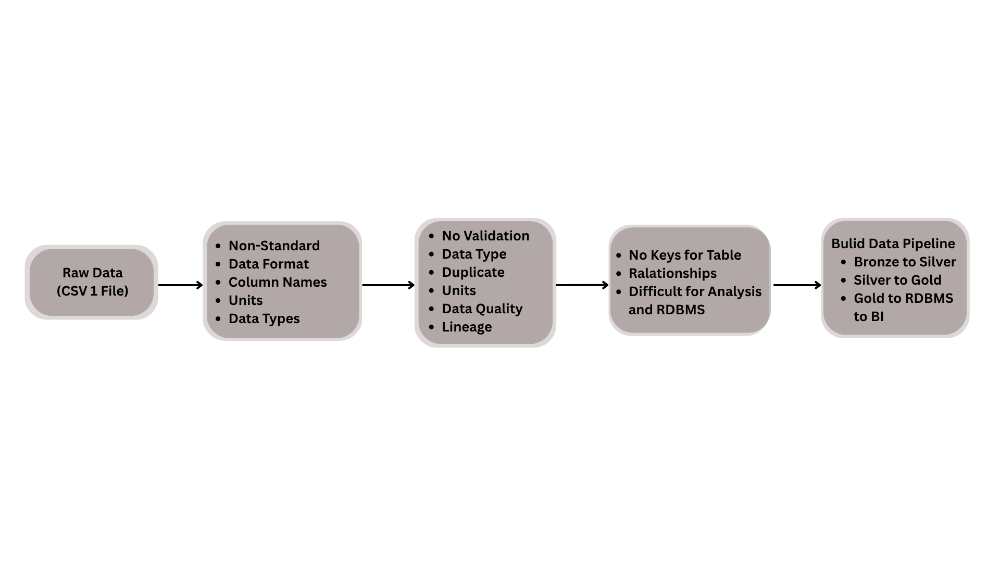

**ทางแก้** คือสร้าง Data Pipeline ที่ทำงานอัตโนมัติ: เก็บ → ทำความสะอาด → ตรวจคุณภาพ → จัดเป็นฐานข้อมูล → Dashboard → Business Insight

### Dataset

| รายการ | ค่า |
|---|---|
| แหล่งที่มา | [🏭 Predicting Manufacturing Defects Dataset (Kaggle)](https://www.kaggle.com/datasets/rabieelkharoua/predicting-manufacturing-defects-dataset) |
| ไฟล์ | [`dataset/manufacturing_defect_dataset.csv`](dataset/) |
| ขนาด | 3,240 แถว × 17 คอลัมน์ (16 features + target) |
| 1 แถว | การผลิต 1 รอบ (batch) |
| Target | `DefectStatus` → `is_high_defect` (1 = High 2,723 batch / 84.04%, 0 = Low 517 batch / 15.96%) |
| Missing / Duplicate | 0 / 0 |

รายละเอียดทุกคอลัมน์ดูที่ [docs/data_dictionary.md](docs/data_dictionary.md)

---

## ผลลัพธ์สำคัญ

| ด้าน | ผล |
|---|---|
| Row reconciliation | ไฟล์ = Bronze = Silver = Gold = PostgreSQL = **3,240 ทุกชั้น** |
| Dirty-data test (15 กรณี) | **19/19 PASS** |
| PK/FK integrity (PostgreSQL) | **14/14 PASS** |
| End-to-end automation (batch ใหม่ 308 แถว) | Job เริ่มเองจาก file arrival, รันครบ 9 task ใน **22 นาที 33 วินาที**, รับ 300 แถวดี, Quarantine 8 แถว (ซ้ำ 5 + ค่าผิด 3), ส่งอีเมลแจ้งเตือนอัตโนมัติ |
| Dashboard | Databricks AI/BI Dashboard 11 datasets / **17 widgets** + หน้า Model |
| Business insight | Controllable factor ที่มีผลชัดมีแค่ 2 ตัว: **ชั่วโมงซ่อม > 10 ชม./สัปดาห์** และ **batch > 800 หน่วย** |
| Operating window | ไม่มี risk flag + ผ่าน QC → High defect เพียง **3.12%** |
| Unknown question | กฎ threshold 4 ข้อตรงกับ label **96.11%** → label น่าจะสร้างจากกฎ ไม่ใช่การนับของเสียจริง |

---

## สถาปัตยกรรม

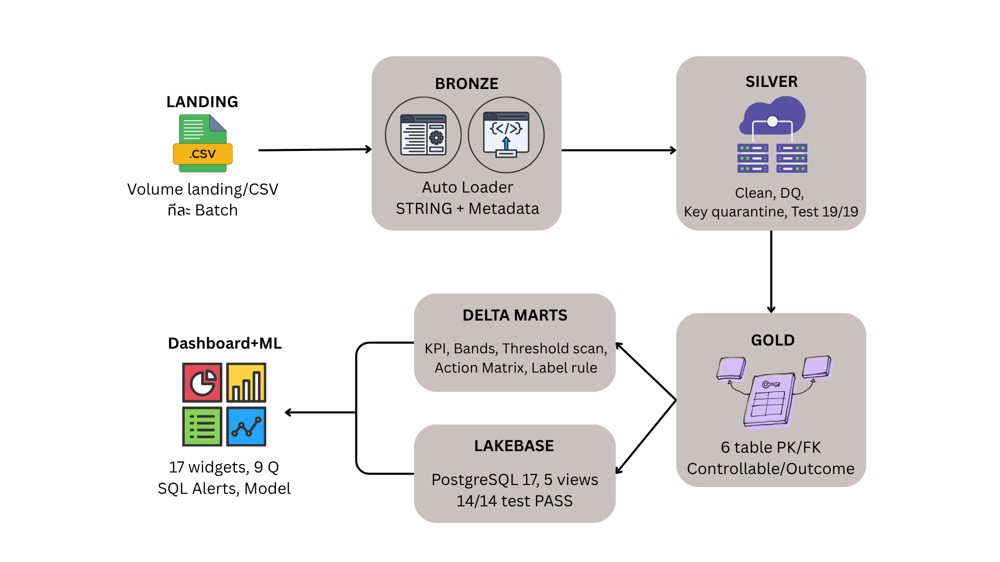

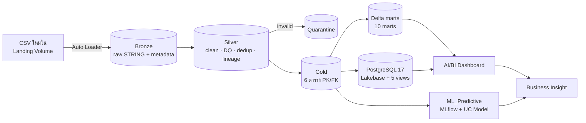

| ชั้น | หน้าที่ |
|---|---|
| **Bronze** (Raw) | เก็บ raw data ตามต้นฉบับ อ่านทุกคอลัมน์เป็น `STRING` พร้อม ingestion metadata (`_source_file`, `_source_file_modified_at`, `_ingested_at`, `_bronze_batch_id`) ตรวจ schema drift และ reconciliation |
| **Silver** (Cleansed & validated) | 7 ขั้น: ตั้งชื่อมาตรฐาน → จับ placeholder 10 แบบ → บังคับชนิดข้อมูล (`try_cast`) → `record_id` (SHA-256) + dedup → DQ rules 30+ ข้อ → Quarantine → Lineage แล้วผ่าน Quality Gate + Delta CHECK constraints 9 ข้อ |
| **Gold** (Business-ready) | แยกเป็น 6 ตารางตาม business domain เชื่อมด้วย `production_id` (1:1) + `batch_360` + 10 analytic marts โหลดเข้า Delta Lake และ PostgreSQL 17 (Lakebase) |

**Tech stack:** Databricks Free Edition (Serverless, Unity Catalog, SQL Warehouse, Workflows, SQL Alerts) · Apache Spark / PySpark · Delta Lake · Auto Loader · Databricks Lakebase (PostgreSQL 17, `pg8000`) · Databricks SDK / Jobs API 2.2 · AI/BI Dashboard (Lakeview API) · MLflow · scikit-learn

<details>
<summary>ETL Flow Diagram และ Flow การทำงานทั้งหมด</summary>

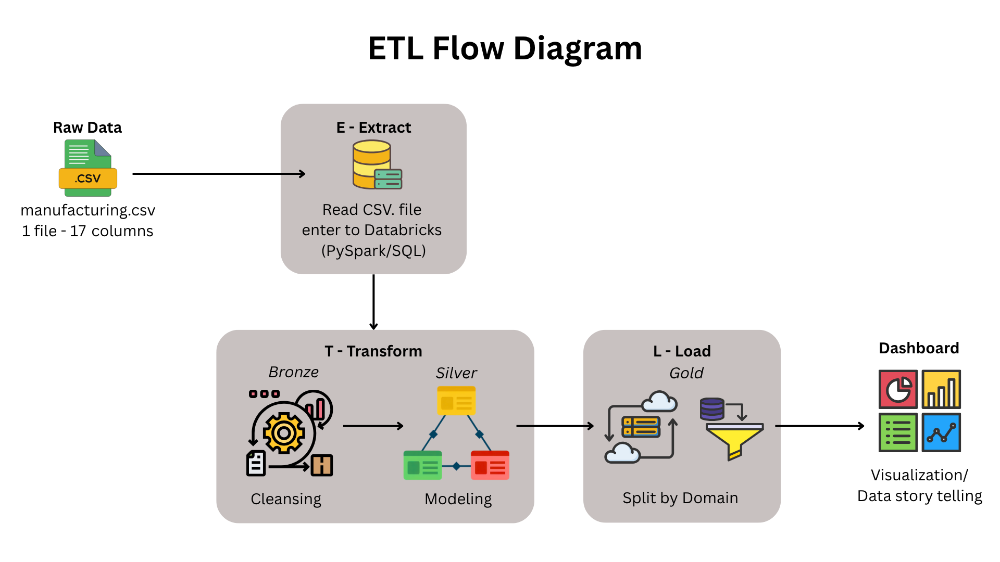
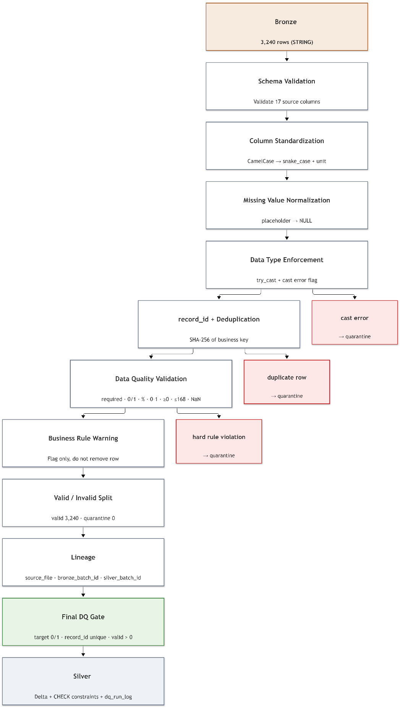
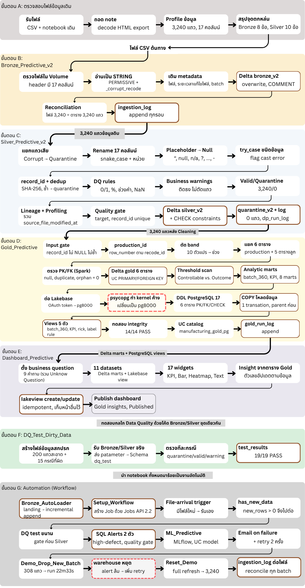

</details>

---

## โครงสร้าง Repository

```
Predictive_Manufaturring/
├── Predictive_Manu/                  # Databricks notebooks (source format .py)
│   ├── Bronze_Predictive_v2.py       # Bronze: อ่าน CSV ทั้งไฟล์ (Manual / DQ test)
│   ├── Bronze_AutoLoader.py          # Bronze: Auto Loader อ่านเฉพาะไฟล์ใหม่ (Automate)
│   ├── Silver_Predictive_v2.py       # Silver: clean + DQ + quarantine + lineage
│   ├── Gold_Predictive.py            # Gold: 6 ตาราง PK/FK + marts + Lakebase
│   ├── Dashboard_Predictive.py       # สร้าง/อัปเดต/publish AI/BI Dashboard
│   ├── ML_Predictive.py              # โมเดลทำนาย high-defect + MLflow
│   ├── DQ_Test_Dirty_Data.py         # พิสูจน์กลไก DQ ด้วยข้อมูลสกปรก 15 กรณี
│   ├── Setup_Workflow.py             # สร้าง Job ด้วย Jobs API 2.2
│   ├── Demo_Drop_New_Batch.py        # สาธิต: วางไฟล์ batch ใหม่ 308 แถว
│   └── Reset_Demo.py                 # คืนสถานะข้อมูลเป็น 3,240 แถว
├── dataset/
│   ├── manufacturing_defect_dataset.csv
│   └── README.md                     # Data card
├── docs/
│   ├── Manufacturing_Defect_Pipeline_Report.pdf   # รายงานฉบับเต็ม
│   ├── Manufacturing_Defect_Pipeline_Slides.pptx  # สไลด์นำเสนอ
│   ├── data_dictionary.md
│   ├── data_quality_testing.md
│   ├── business_insights.md
│   ├── images/                       # ภาพประกอบจากรายงาน
│   └── sql/adhoc_queries.sql         # ตัวอย่าง ad-hoc query บน Gold
├── CHANGELOG.md
├── CITATION.cff
├── requirements.txt
├── LICENSE
└── README.md
```

---

## Notebooks

| Notebook | หน้าที่ | คำสั่ง/เทคนิคสำคัญ |
|---|---|---|
| `Bronze_Predictive_v2` | อ่าน CSV ดิบ (Manual) | `StructType` ทุกคอลัมน์ `StringType` · `mode PERMISSIVE` + `_corrupt_record` · `_metadata.file_path` |
| `Bronze_AutoLoader` | อ่านเฉพาะไฟล์ใหม่ (Automate) | `readStream.format("cloudFiles")` · `checkpointLocation` · `trigger(availableNow=True)` · `taskValues.set` |
| `Silver_Predictive_v2` | clean + DQ | `isin(MISSING_VALUES)` · `try_cast` · `sha2(concat_ws)` · `row_number().over(Window)` · `array_compact` · `ADD CONSTRAINT CHECK` |
| `Gold_Predictive` | 6 ตาราง + marts + PostgreSQL | `row_number` → `production_id` · `left_anti` join (orphan) · PRIMARY/FOREIGN KEY · `scan_threshold()` · `COPY FROM STDIN` · `expect_rejected()` |
| `Dashboard_Predictive` | Dashboard | Lakeview API · 11 datasets · 17 widgets · publish |
| `ML_Predictive` | โมเดลทำนาย | `train_test_split(stratify)` · `GradientBoostingClassifier` · `mlflow.register_model` · alias `champion` |
| `DQ_Test_Dirty_Data` | พิสูจน์ DQ | `mutate()` แก้ค่า 1 จุด/เคส · `dbutils.notebook.run(notebook, timeout, params)` |
| `Setup_Workflow` | สร้าง Job | `condition_task new_rows > 0` · `file_arrival` trigger · `max_retries` · `/api/2.2/jobs/reset` |
| `Demo_Drop_New_Batch` | สาธิต | seed คงที่: แถวใหม่ 300 + ซ้ำ 5 + ค่าผิด 3 (QualityScore 150, DefectStatus 2, ProductionCost "abc") |
| `Reset_Demo` | คืนสถานะ | ย้าย batch_002 ไป `landing_archive` แล้วสั่ง Job ด้วย `full_refresh = true` |

---

## Data Model (Gold)

Relational model แบบ **Normalized ตาม business domain** + ตาราง **Denormalized สำหรับอ่าน**

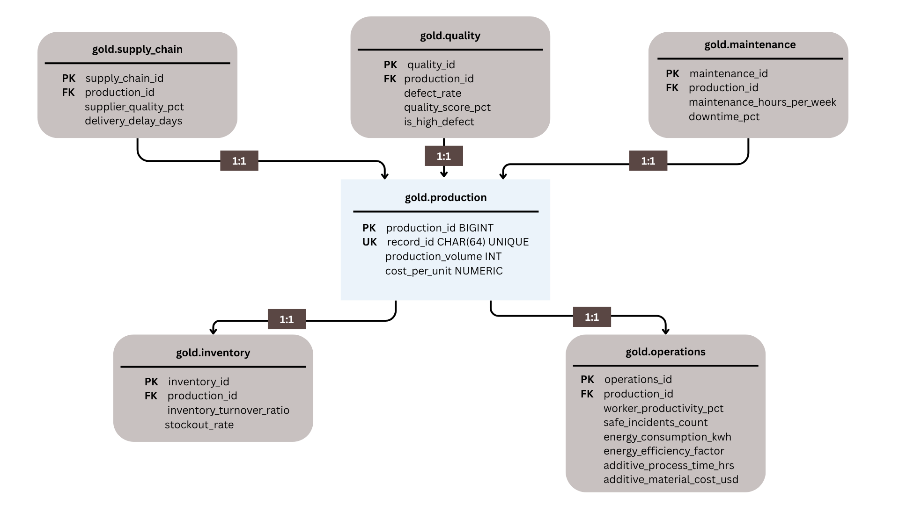

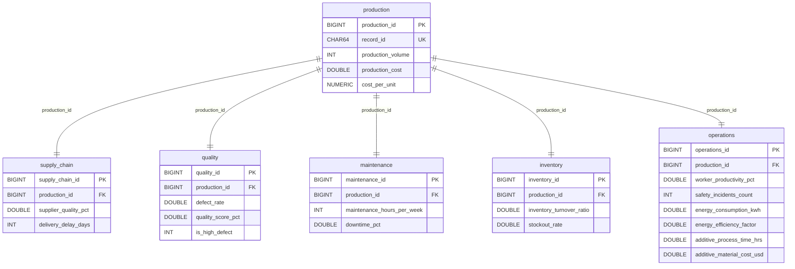

| ระดับ | รูปแบบ | ตาราง → ใช้ทำอะไร |
|---|---|---|
| RDBMS core | Normalized, PK/FK, 1:1 | `production` + 5 ตารางลูก → เก็บข้อมูลจริง บังคับ integrity |
| Wide table | Denormalized (join 6 ตาราง) | `batch_360` → flags, ML, ad-hoc query |
| Marts / Views | Aggregated | 10 marts + 5 PostgreSQL views → Dashboard ตอบ 9 คำถาม |

- **Key:** `production_id` = surrogate key (BIGINT, `row_number` เรียงตาม `record_id` → รันซ้ำได้ค่าเดิม) · `record_id` = natural key (SHA-256, UNIQUE)
- **FK (PostgreSQL):** `production_id BIGINT NOT NULL UNIQUE REFERENCES gold.production(production_id) ON DELETE CASCADE`
- **FK (Delta):** informational constraint ของ Unity Catalog
- **Analytic marts:** `batch_360`, `kpi_overview`, `mart_threshold_scan`, `mart_driver_bands`, `mart_driver_impact`, `mart_risk_matrix`, `mart_risk_segment`, `mart_action_matrix`, `mart_label_rule`, `mart_maint_hours_curve` (+ `gold_run_log`)
- **PostgreSQL views:** `vw_batch_360`, `vw_kpi_overview`, `vw_defect_by_maintenance`, `vw_risk_segment`, `vw_label_rule_check` (ลงทะเบียนเป็น UC catalog `manufacturing_gold_pg`)

---

## Automation (Databricks Workflow)

Job **`Manufacturing_Defect_Pipeline`** สร้างด้วยโค้ด (`Setup_Workflow`) จึงสร้างซ้ำได้เหมือนเดิมทุกครั้ง: **แค่วางไฟล์ใหม่ ระบบทำเองครบ ไม่ต้องกดอะไร**

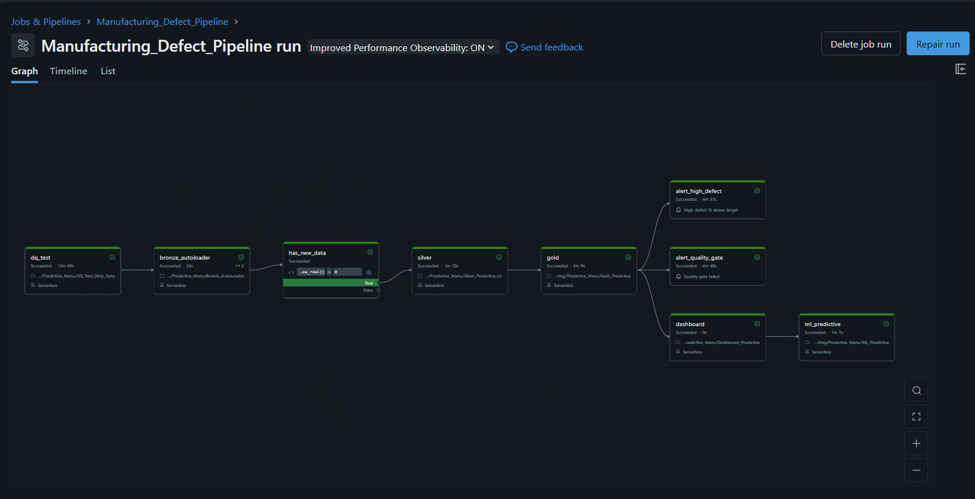

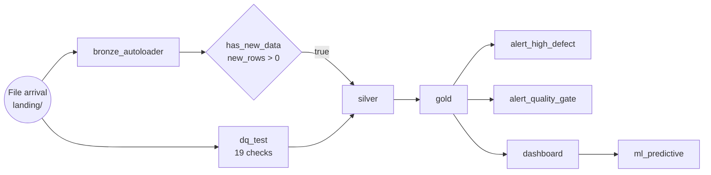

| Task | หน้าที่ |
|---|---|
| `dq_test` | รัน Bronze/Silver ตัวจริงกับข้อมูลสกปรก 15 กรณี ต้องผ่าน 19/19 ก่อนแตะข้อมูลจริง |
| `bronze_autoloader` | อ่านไฟล์ใหม่ append ลง Bronze ตรวจ header/reconciliation ทีละไฟล์ ส่ง `new_rows` |
| `has_new_data` | Condition task: ถ้าไม่มีข้อมูลใหม่ task ที่เหลือถูกข้าม (ไม่เปลือง compute) |
| `silver` / `gold` | ทำความสะอาด → แยก 6 ตาราง, threshold scan, marts, โหลด Lakebase, integrity test |
| `alert_high_defect` / `alert_quality_gate` | SQL Alert (retry 2) แจ้งเตือนเมื่อ high-defect % เกินเป้า หรือมีแถวใน quarantine / row count ไม่ตรง |
| `dashboard` / `ml_predictive` | รีเฟรช Dashboard และเทรนโมเดลใหม่ |

ตั้งค่า: `file_arrival` trigger (min 60 s, wait after last change 60 s) · `max_concurrent_runs = 1` + queue · `email_notifications.on_failure`

---

## Data Quality & Testing

| การทดสอบ | ผล |
|---|---|
| Row count ทุกชั้น (ไฟล์ = Bronze = Silver = Gold = PostgreSQL) | PASS · 3,240 ทุกชั้น |
| ข้อมูลสกปรก 15 แบบ (เช่น คะแนน 150, `'abc'` ในช่องตัวเลข, ชั่วโมงซ่อม 200, แถวซ้ำ) | PASS 19/19 |
| PK/FK integrity + negative test ใน PostgreSQL | PASS 14/14 |
| End-to-end automation (ไฟล์ใหม่ 308 แถว) | PASS · 300 ดี, 8 quarantine |
| Reset (full refresh) | PASS · 3,240 / 0 quarantine |

รายละเอียด DQ rules, test cases T01–T15 / R1–R5 และ negative test ดูที่ [docs/data_quality_testing.md](docs/data_quality_testing.md)

---

## Business Insight (Q1–Q9)

ก่อนตีความ ตัวแปรถูกแยกเป็น 2 บทบาท:
- **Controllable** (ทีมปรับได้ก่อน/ระหว่างผลิต, 8 ตัว): ใช้ทำ risk score ก่อนปล่อย batch
- **Outcome** (`defect_rate`, `quality_score`, รู้หลังผลิต): ใช้เป็น QC alert / KPI ไม่ใช่สาเหตุ

Threshold ได้จากการ scan ทุกจุดตัด แล้วเลือกจุดที่ high-defect % ของสองฝั่งต่างกันมากที่สุด (แต่ละฝั่ง ≥ 5% ของ batch) ตัวที่ต่างกัน ≥ 15 pp ถือเป็น key factor

| # | คำถาม | คำตอบ |
|---|---|---|
| Q1 | คุณภาพโดยรวม/กระทบต้นทุน | 84.04% ของ batch เป็น High defect คิดเป็น 84.38% ของต้นทุน ($40.25M) → ตั้ง high-defect % เป็น KPI หลัก |
| Q2 | Controllable factor ที่มีผลมากสุด | ชั่วโมงซ่อม > 10 (gap 25.7 pp) และ batch > 800 (gap 16.2 pp) |
| Q3 | ชั่วโมงซ่อมบำรุง | > 10 ชม./สัปดาห์ → 95.6% เทียบ 69.9% (ความเสี่ยง "กระโดด") → predictive maintenance / overhaul |
| Q4 | Defect rate สำหรับ QC alert | > 3.0 → 96.2% เทียบ 74.4% → SPC alert |
| Q5 | Quality score สำหรับ QC alert | < 75 → 95.8% เทียบ 77.2% → QC gate |
| Q6 | batch ใหญ่เสี่ยงกว่าไหม | > 800 → 96.7% เทียบ 80.4% แต่ต้นทุน/หน่วยถูกสุด ($13.82) → เพิ่ม QC sampling ไม่ต้องลดขนาด |
| Q7 | ปัจจัยที่ไม่ช่วยอธิบาย | stockout, energy efficiency, supplier, downtime, productivity, delivery delay (gap ≤ 8.4 pp) |
| Q8 | Operating window | ไม่มี risk flag + ผ่าน QC → 3.12% (417 batch); เกิน flag ใดข้อหนึ่ง → 93–97% |
| Q9 | Unknown: label มาจากไหน | กฎ 4 ข้อ (ซ่อม > 10, batch > 800, defect rate > 3, quality score < 75) ตรงกับ label 96.11% |

รายละเอียดและตาราง band ดูที่ [docs/business_insights.md](docs/business_insights.md)

<details>
<summary>Dashboard: Manufacturing Defect - Gold Insights</summary>

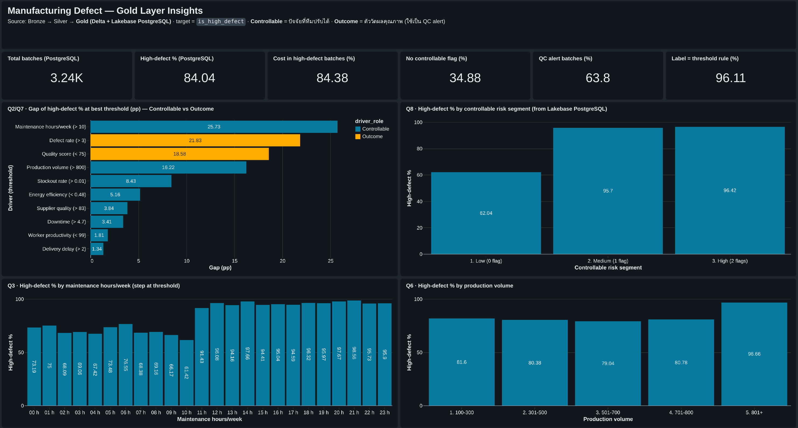
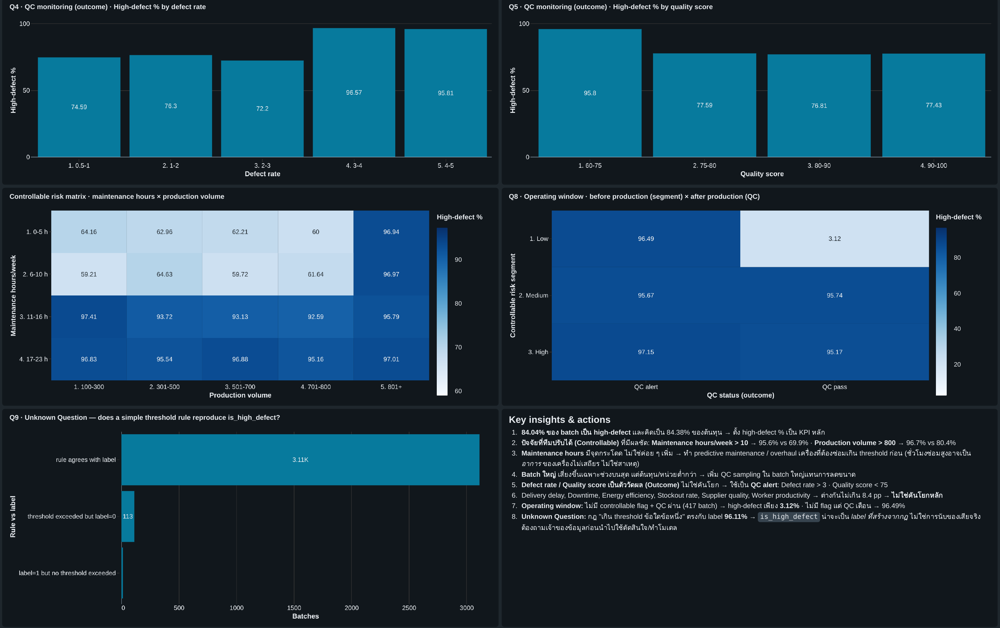

</details>

---

## Machine Learning

`ML_Predictive` เป็น task สุดท้ายของ Workflow จึงเทรนใหม่ทุกครั้งที่ข้อมูลเปลี่ยน
Input: `gold_predictive.batch_360` · split 80/20 แบบ stratified (`random_state = 42`, test 648 batch) · MLflow experiment `manufacturing_defect_model` · โมเดลที่ ROC-AUC สูงสุด register เป็น `gold_predictive.defect_model` alias `champion`

| วิธี (test 648 batch) | ROC-AUC | F1 | Balanced Acc | ทาย Low defect ถูก (จาก 103) |
|---|---|---|---|---|
| กฎ 4 ข้อ (baseline) | **0.921** | **0.983** | **0.920** | 87 |
| Gradient Boosting (200 trees, lr 0.05, depth 3) | 0.916 | 0.981 | 0.918 | 87 |
| Logistic Regression (balanced) | 0.855 | 0.820 | 0.759 | 82 |
| GB ใช้แค่ข้อมูลก่อนผลิต (14 ตัว) | 0.805 | 0.910 | 0.529 | 8 |

โมเดลที่ซับซ้อนกว่ายังไม่ชนะกฎง่าย ๆ 4 ข้อ ซึ่งยืนยัน Q9 ข้อควรระวัง: `defect_rate` และ `quality_score_pct` เป็น Outcome ถ้าใช้เป็น feature เพื่อทำนายก่อนผลิตจะเกิด **label leakage**

---

## วิธีติดตั้งและรัน

> ทุก notebook รันบน **Databricks** (ทดสอบบน Free Edition, Serverless) ไม่ได้ออกแบบให้รันบนเครื่อง local

1. **Import notebooks:** ผูก repo นี้เป็น Git folder ใน Databricks (Workspace → Create → Git folder) หรือ import ไฟล์ใน `Predictive_Manu/`
2. **เตรียม Unity Catalog:** สร้าง catalog `predictive_manufacring_defect` พร้อม schema `bronze_preditive`, `silver_predictive`, `gold_predictive`, `dq_test` และ volume สำหรับไฟล์ต้นทาง / `landing` / `checkpoints` / `landing_archive` (ชื่อสะกดตามโค้ด)
3. **อัปโหลดข้อมูล:** วาง `dataset/manufacturing_defect_dataset.csv` ที่ `/Volumes/predictive_manufacring_defect/bronze_preditive/bronze_predic/`
4. **(สำหรับ RDBMS) สร้าง Lakebase:** project `manufacturing-defect-gold` (PostgreSQL 17) branch `production` การเชื่อมต่อใช้ OAuth token อายุสั้นผ่าน Databricks SDK (ไม่มี password ในโค้ด)
5. **รันแบบ Manual:** `Bronze_Predictive_v2` → `Silver_Predictive_v2` → `Gold_Predictive` → `Dashboard_Predictive` → `ML_Predictive` แล้วรัน `DQ_Test_Dirty_Data` เพื่อพิสูจน์กลไก DQ
6. **รันแบบ Automate:** สร้าง SQL Alert 2 ตัว (High-defect % above target, Quality gate failed) แล้วรัน `Setup_Workflow` เพื่อสร้าง Job `Manufacturing_Defect_Pipeline`
7. **สาธิต:** รัน `Demo_Drop_New_Batch` (Job จะเริ่มเอง) แล้วใช้ `Reset_Demo` เพื่อคืนข้อมูลเป็น 3,240 แถว

Dependencies ที่ notebook ติดตั้งเองด้วย `%pip` ดูได้ที่ [`requirements.txt`](requirements.txt)

> **Tip (Free Edition):** ก่อนสาธิต ให้ Terminate compute ของ notebook ที่ไม่ใช้ และเปิด SQL Warehouse ไว้ก่อน เพื่อไม่ให้ชนโควตา serverless (`RESOURCE_EXHAUSTED`)

---

## ข้อจำกัดและแนวทางในอนาคต

**ข้อจำกัด**
- Dataset ไม่มี business key จริง (batch id, วันที่, สายการผลิต) จึงต้องสร้าง key จาก hash และวิเคราะห์เชิงเวลาไม่ได้
- ข้อมูลมีลักษณะคล้าย synthetic data และ label ตรงกับกฎ threshold 96.11% ข้อสรุปจึงเป็น **ความสัมพันธ์ ไม่ใช่เหตุและผล**
- Threshold ได้จากการ scan หลายจุด (multiple testing) จึงควรยืนยันกับข้อมูลชุดใหม่
- Target ไม่สมดุล (84% high defect)
- Free Edition มีโควตา serverless จำกัด และ `psycopg` ใช้บน serverless ไม่ได้ (ใช้ `pg8000` แทน)
- Silver/Gold เป็น full recompute เหมาะกับข้อมูลขนาดเล็ก

**แนวทางในอนาคต**
- แยก `dq_test` เป็น Job ที่รันตามตาราง ให้ Job หลักเหลือประมาณ 10 นาที/batch
- เปลี่ยน Silver/Gold เป็น incremental `MERGE` และจัดการ Job/โค้ดด้วย Databricks Asset Bundles (CI/CD)
- เก็บข้อมูลก่อนผลิตเพิ่ม แล้วสร้างโมเดลจากตัวแปร Controllable เท่านั้น พร้อม model monitoring (drift)
- ตั้ง schedule refresh ของ Dashboard

---

## เอกสารประกอบ

- 📄 [รายงานฉบับเต็ม (PDF)](docs/Manufacturing_Defect_Pipeline_Report.pdf)
- 📊 [สไลด์นำเสนอ (PPTX)](docs/Manufacturing_Defect_Pipeline_Slides.pptx)
- 🧾 [Data dictionary](docs/data_dictionary.md) · [Data quality & testing](docs/data_quality_testing.md) · [Business insights](docs/business_insights.md) · [SQL examples](docs/sql/adhoc_queries.sql)

---

## ผู้จัดทำ

**ชมพูนุช สุนทรพจน์** (JUJU) · GitHub [@juchompunuch-cpu](https://github.com/juchompunuch-cpu)

**อาจารย์ผู้สอน:** Mr. Aekanun Thongtae (AI & Data Science Consultant)

**อ้างอิง**
- Dataset: [Predicting Manufacturing Defects Dataset](https://www.kaggle.com/datasets/rabieelkharoua/predicting-manufacturing-defects-dataset), Kaggle
- หลักการจัดการ Missing Value: *Dealing with Missing Values*. Lewinson, E. (2020). *Python for Finance Cookbook*. Packt.

## License

เผยแพร่ภายใต้ [MIT License](LICENSE)
